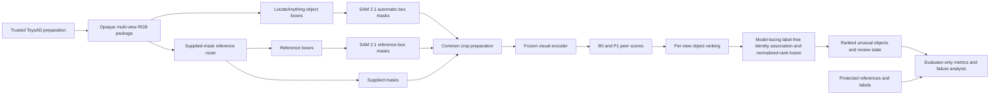
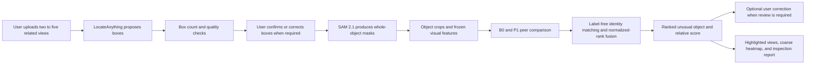

# System architecture

## Purpose

Visual Peer Inspector ranks unusual objects by comparing each object with the
other objects visible in the same scene. It uses multiple RGB views so that a
decision can be supported by more than one camera position.

The implementation has two related journeys:

1. a controlled research pipeline used to select and evaluate the method; and
2. a web application pipeline used to process new user images.

The research pipeline keeps labels and source metadata outside the model path.
The application pipeline replaces dataset references with user confirmation
when automatic object discovery or identity matching is uncertain.

## Research and evaluation pipeline

The supplied-mask route is the scientific reference. The reference-box and
automatic-box routes measure how performance changes when prompted
segmentation and automatic object discovery are introduced.

## Web application pipeline

The application must return a review state when boxes, object identity, view
support, or peer evidence are insufficient. It must not silently convert an
uncertain result into a confident anomaly claim.

## Component responsibilities

| Component | Responsibility | Not responsible for |
| --- | --- | --- |
| Trusted preparation | Selects scenes, enforces roles, resolves private source records, and builds opaque resources | Model inference |
| LocateAnything | Proposes object-level bounding boxes from RGB images | Segmentation, anomaly scoring, or identity tracking |
| SAM 2.1 | Produces a whole-object mask from a supplied box | Finding the defective region or scoring anomalies |
| Crop preparation | Applies the same masking, padding, and resizing rules to every route | Preserving full-scene geometry |
| Frozen visual encoder | Produces global and patch-level object features | Deciding which object is anomalous by itself |
| B0 | Compares one global feature with the leave-one-out peer mean | Local defect localisation |
| B1 | Retains the tested median pairwise baseline for comparison | Part of the promoted application method |
| P1 | Compares local patch features and produces a coarse mismatch map | Pixel-accurate defect segmentation |
| Geometry branch | Planned future scoring for pose and arrangement changes | Part of the current DS2 B0 or P1 result |
| Identity and fusion | Uses model-facing appearance and geometry evidence for label-free one-to-one matching, permits explicit unmatched objects, and applies mean normalized-rank fusion | Inventing correspondence when evidence is weak |
| Evaluator | Joins already frozen predictions with protected references for metrics and failure analysis | Supplying information to model execution or application fusion |

## Route names

Use these names consistently in notebooks, reports, and code:

| Route | Meaning |
| --- | --- |
| `supplied_mask` | Dataset-provided whole-object mask used as the scientific reference |
| `reference_box` | SAM 2.1 prompted with a box derived from the supplied mask |
| `automatic_box` | SAM 2.1 prompted with a frozen LocateAnything box |

The term *oracle* may be used when explaining the supplied reference, but
machine-readable route names must remain the three names above.

## Implementation map

| Area | Main repository location | Notebook stage |
| --- | --- | --- |
| Source verification and scene selection | `src/visual_peer_inspector/data/`, `chunks.py`, `verification.py` | 01 and 02 |
| Opaque model package | `src/visual_peer_inspector/data/model_safe_package.py` | 03 |
| Object proposals | `src/visual_peer_inspector/models/locateanything.py` | 04 |
| SAM prompts and inference | `src/visual_peer_inspector/data/sam_prompt_package.py`, `models/sam2.py`, `workflows/sam_ds0.py` | 05 |
| Protected proposal and mask evaluation | `src/visual_peer_inspector/evaluation/`, `workflows/mask_evaluation_ds0.py` | 06 |
| Representation and peer comparison | `src/visual_peer_inspector/baseline.py`, with the multi-view modules added in Notebook 07 | 07 |
| Reproducible entry points | `notebooks/` and `scripts/` | All stages |
| Verification | `tests/` and stage-specific requirement locks | All stages |

Notebook cells should coordinate these modules rather than contain a second
implementation. Report folders contain reviewed evidence, not reusable model
logic.

## Data zones and leakage controls

### Trusted preparation

Trusted preparation may read source paths, object order, labels, categories,
base-asset groups, protocol roles, and private crosswalks. It creates derived
resources with opaque identifiers and declared schemas.

### Model execution

Model jobs receive only the inputs required by their stage, such as opaque RGB
paths, boxes, masks, crops, or feature records. The following fields are
forbidden in model-facing resources:

- anomaly labels or anomaly counts;
- source object order or source indices;
- source names, paths, or private identifiers;
- category and base-asset information;
- development, calibration, internal-lock, or official-test roles; and
- evaluator references or protocol decisions.

### Evaluator-only analysis

Evaluator code verifies prediction hashes and configuration records before it
opens protected references. It reports paired aggregate metrics, subgroup
results, runtime, failures, and confidence intervals without returning labels
to the model path.

## Experiment gates

| Gate | Scope | Purpose | Current status |
| --- | --- | --- | --- |
| DS0 | 20 scenes, 20 views, 400 images | Validate packaging, proposals, segmentation, repeatability, and evaluator separation | Complete; candidate evidence supports progression |
| DS1 | 100 scenes, all 20 views | Screen proposal settings, mask routes, encoders, and scoring | Complete; prompt freeze verified on Kaggle Version 4 |
| DS2 | Separate 300 scenes, all 20 views | Confirm the selected component settings without retuning | Frozen model run and protected evaluation complete |
| Development scale | Full 1,000-scene development role | Run the frozen pipeline, freeze label-free identity and lock the output contract | Notebooks 08D to 08F built and locally checked; Kaggle evidence pending |
| Calibration | 600 scenes | Create prediction-only outputs, then freeze review behaviour | Notebooks 09A and 09B built and locally checked; Kaggle evidence pending |
| Internal lock | 400 scenes | Lock predictions, then evaluate once without retuning | Notebooks 09C and 09D built and locally checked; Kaggle evidence pending |
| Official test | 715 seen and 2,437 unseen scenes | Run separate frozen inference and one sealed evaluation | Notebooks 10R to 10B built and locally checked; Kaggle evidence pending |
| Optional full pool | 4,107 eligible training scenes | Describe the unchanged frozen route after official results are fixed | Notebooks 11R to 11B built and locally checked; execution remains optional |

The optional 4,107-scene analysis is a post-freeze sensitivity check. It must
not be used to retune the primary 2,000-scene experiment.

## Current implementation status

Notebooks 01 to 08C are complete and merged. Fifteen ordered core notebook
sources from 08D through 10B and three optional Notebook 11 sources are built
and locally checked, but they do not yet have real Kaggle evidence. DINOv2-small with P1 is the working freeze, B0
remains the baseline, and B1 is not promoted. The DS2
release contains 300 untouched scenes and 6,000 views. The Notebook 04.3
development evaluation selects `individual object` with area filtering, NMS at
0.75, and an eight-proposal outlier safeguard. Kaggle Version 4 verified this
selection. Notebook 08B kept the model revision, prompt and post-processing
fixed. Its separately hashed operational policy used 4,096 tokens, at most two
attempts, a 75-second attempt timeout, and explicit zero-proposal records for
terminal generation failures. Notebook 08C opened protected evaluator data
only after the prediction hashes were frozen.

The frozen DS2 run processed 6,000 images. LocateAnything reached 0.9383 recall
at box IoU 0.50 and found every reference object in 0.8792 of images. The two
terminal generation failures and 36 genuine zero-proposal images were kept as
misses. SAM 2.1 reached 0.9478 mean mask IoU with reference boxes and 0.8834
through the automatic route.

DINOv2-small with P1 remains the working appearance method. On the supplied
mask route, P1 improved 20-view scene average precision over B0 by 0.0505. The
paired 95 percent interval was 0.0249 to 0.0777. The declared three-view
automatic route reached 0.6531 scene average precision with mean-rank fusion.

The automatic and assisted routes remain separate. LocateAnything is an
automatic proposal assistant. A user-confirmed box route remains necessary
when boxes are missing, loose, duplicated, or attached to the background.

## Claim limits

- ToysAD scenes contain at least one anomalous object, so the project does not
  establish false-alarm behaviour on all-normal scenes.
- Whole-object masks are not defect masks.
- P1 heatmaps indicate feature mismatch, not a causal or pixel-accurate defect.
- Twenty dataset views are repeated observations of one scene, not twenty
  independent samples.
- The automatic route is the current application candidate, with an assisted
  fallback. It is not a fully automatic production claim.
- DINOv2-small and P1 are frozen for DS2. The label-free identity method and
  review-policy procedures are implemented, but their final immutable records
  exist only after Notebooks 08F and 09B complete on Kaggle.

## Evidence and reproducibility

GitHub stores code, tests, notebook sources, dependency locks, compact tables,
figures, hashes, and sanitized run records. Kaggle stores the private source
and large versioned model inputs or outputs. ClearML stores approved aggregate
metrics, plots, configuration, runtime, and provenance. Credentials and private
data remain outside all tracked files.
