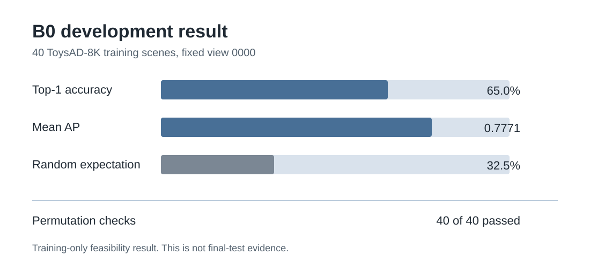

# B0 development result

Run date: 7 August 2026.

## Purpose

This run checks whether the dataset loader, frozen feature extractor and B0
score work together on more than a few examples. It uses training scenes only.

## Fixed setup

- 40 scenes from the official training split
- 22 toy categories and 40 different base assets
- 32 one-anomaly scenes and 8 two-anomaly scenes
- Fixed view `0000`
- Supplied object segmentation masks
- Mask threshold 128 and 15 percent crop padding
- Frozen `facebook/dinov2-small`
- Last-layer CLS feature
- B0 cosine distance from the leave-one-out peer mean
- Apple MPS device

The exact cohort and model revisions are stored in
`data/manifests/development_40.json`.

## Result

| Measure | Value |
| --- | ---: |
| Scenes | 40 |
| Top-1 correct | 26 of 40, or 65.0% |
| Mean scene average precision | 0.7771 |
| Random top-1 expectation | 13.02 of 40, or 32.5% |
| Exact permutation checks | 40 of 40 |

The random value is calculated from each scene's anomaly-to-object ratio. It is
not a repeated random baseline or a confidence interval.

## Reproduction check

The workflow was rerun from the recreated repository on 9 August 2026 using
CPU. It reproduced the same 26 of 40 top-1 count, 0.7771 mean average precision
and exact permutation checks. The local extraction and full result file remain
ignored because they contain generated data.

## Interpretation

B0 is better than uniform guessing on this fixed development cohort. It still
misses 14 scenes, so it is not strong enough to become the final method. The
result does not define a threshold and does not use the official seen-test or
unseen-test splits.

## Next experiment

1. Inspect the 14 missed scenes without changing the cohort.
2. Use the completed B1 comparison to identify ranking changes.
3. Implement P1 patch comparison and inspect its heatmaps.
4. Lock the development protocol and thresholds before final evaluation.

B1 has now been run on the same cohort. It matched B0's top-1 count and had a
slightly lower mean average precision. See the
[B1 development comparison](b1-development.md).

The tracked machine-readable summary is
[`b0-development-summary.json`](b0-development-summary.json).
