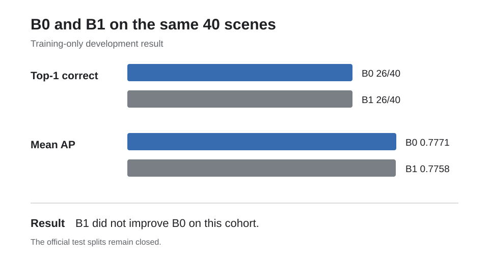

# B1 development comparison

Run date: 9 August 2026.

## Purpose

This experiment asks whether a robust peer comparison improves the B0 result.
B1 uses the same images, object crops, DINOv2 features and fixed development
cohort as B0.

## Method

For each object, B1 measures cosine distance to every other object in the
scene. Its anomaly score is the median of those distances. A larger score means
the object differs more from its peers.

## Result

| Measure | B0 | B1 | Change |
| --- | ---: | ---: | ---: |
| Top-1 correct | 26 of 40 | 26 of 40 | 0 |
| Top-1 accuracy | 65.0% | 65.0% | 0.0 points |
| Mean scene average precision | 0.7771 | 0.7758 | -0.0013 |
| Exact permutation checks | 40 of 40 | 40 of 40 | 0 |

No scene changed from a top-1 success to a failure or from a failure to a
success. Seven scene rankings changed enough to alter average precision.

## Interpretation

B1 did not improve B0 on this development cohort. The median made some rankings
different, but the overall top-1 result stayed the same and mean average
precision was slightly lower. This is a negative development result and should
not be presented as a performance gain.

The official seen-test and unseen-test splits remain closed. The next work is
to inspect the 14 shared misses and implement the P1 patch baseline.

The tracked machine-readable summary is
[`b1-development-summary.json`](b1-development-summary.json).
