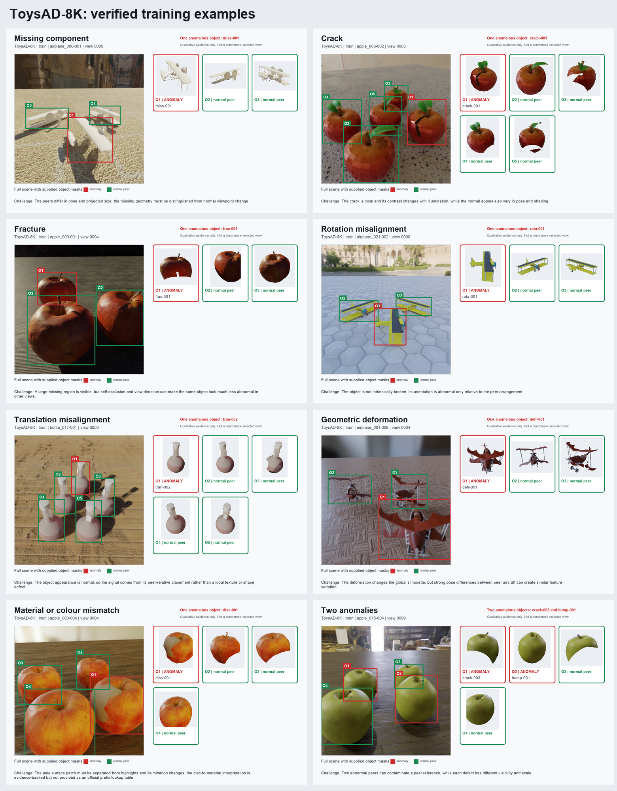

# Problem and method

## Problem

The project asks a simple question:

> When several similar objects appear in multiple views of one scene, which
> object is most unusual compared with its peers?

The system does not depend on a large reference library of normal products.
Objects visible in the uploaded scene act as references for each other.

The examples include missing parts, cracks, fractures, rotation, translation,
shape deformation, material or colour changes, and scenes with two anomalies.

## Main challenges

1. Normal objects can differ in pose, size, lighting, and visibility.
2. A defect may affect only a small part of an object.
3. Rotation and translation depend on the arrangement of peer objects.
4. Several unusual objects can weaken the peer reference.
5. ToysAD-8K stores anomalous objects first in metadata order.
6. The inspected release has no all-normal scenes.
7. The same object must be matched across views before evidence is combined.

## Processing stages

The complete data flow and trust boundary are documented in
[System architecture](architecture.md).

### 1. Object proposals

NVIDIA LocateAnything-3B proposes object bounding boxes from each RGB view. It
is an object proposal component, not an anomaly detector. The supplied dataset
geometry is used only by the evaluator and by the controlled reference route.

### 2. Object masks

SAM 2.1 receives one box prompt for each object and produces a mask. Three
routes are kept separate throughout the experiments:

| Route | Region source | Purpose |
| --- | --- | --- |
| `supplied_mask` | Dataset mask | Oracle reference for ranking |
| `reference_box` | Dataset box passed to SAM 2.1 | Segmentation upper bound |
| `automatic_box` | LocateAnything box passed to SAM 2.1 | Deployment candidate |

SAM 2.1 segments prompted regions. It does not decide whether an object is
unusual.

### 3. Common object preparation

All routes use the same mask quality checks, square crop, fixed padding,
background treatment, and encoder input size. This keeps route comparisons
focused on region quality rather than unrelated preprocessing differences.

### 4. Frozen visual representation

A frozen visual encoder converts each prepared object into a global feature
vector and a set of patch features. The bounded DS1 screen selected
DINOv2-small for the confirmation stage.

### 5. Peer comparison

The first ranking methods are:

- **B0, whole-object peer mean:** one minus the cosine similarity between an
  object and the mean feature of its peers.
- **B1, median pairwise distance:** the median cosine distance from one object
  to every other object in the scene.
- **P1, patch comparison:** local patch matching for small or spatially limited
  differences.

B0 is the simple anchor. B1 tested a median pairwise rule but was not promoted.
P1 adds local evidence and is the working scorer for confirmation. It can
produce a coarse unusual-region heatmap. That heatmap is supporting evidence,
not a pixel-accurate defect mask.

### 6. Multi-view evaluation

Per-view rankings remain visible. In the current DS2 evaluator, protected
references associate automatic proposals with stable object identities only
after predictions are hash locked. This measures the value of multi-view
fusion under known correspondence. It does not yet prove label-free identity
matching for the web application. Geometry-based anomaly scoring remains
planned work and is not part of the current B0 or P1 result.

## Current evidence

| Stage | Evidence | Status |
| --- | --- | --- |
| Full-dataset EDA | 7,396 catalogue scenes and 4,107 eligible scenes | Complete |
| Primary selection | 2,000 scenes split 1,000 / 600 / 400 | Complete |
| DS0 proposal run | 400 images and 1,616 proposals with no operational failures | Complete |
| DS0 SAM run | 3,256 masks across the reference-box and automatic-box routes | Complete |
| DS0 mask evaluation | Automatic-route recall at mask IoU 0.75 of 0.9396 and mean matched mask IoU of 0.9485 | Complete |
| Historical ranking baseline | B0 and B1 each ranked an anomaly first in 26 of 40 scenes | Reproducible baseline |
| DS1 proposal screen | 2,000 images; 0.94494 proposal recall and 424 missed objects | Complete; automatic route needs review |
| DS1 prompt and policy follow-up | `individual object` with NMS and an eight-proposal safeguard: 0.97332 precision, 0.96195 recall, 293 missed objects, 0.918 complete detection | Verified on Kaggle Version 4 |
| DS1 representation screen | DINOv2-small P1 average precision of 0.66721 on supplied masks | Complete working freeze |
| DS2 confirmation release | 300 scenes, 6,000 RGB images, and 23,100 visible object masks | Complete |
| DS2 automatic proposals | 0.9350 precision, 0.9383 recall, 0.9366 F1, and 0.8792 complete-image rate at box IoU 0.50 | Complete development confirmation |
| DS2 SAM 2.1 | Mean mask IoU of 0.9478 with reference boxes and 0.8834 with automatic boxes | Complete development confirmation |
| DS2 peer ranking | P1 improved supplied-mask 20-view scene AP over B0 by 0.0505, with a paired 95 percent interval of 0.0249 to 0.0777 | Complete development confirmation |
| DS2 three-view route | Automatic-box P1 with mean-rank fusion reached 0.6531 scene AP and 0.4633 top-1 accuracy | Complete development confirmation |

The historical 40-scene baseline produced mean scene average precision of
0.7771 for B0 and 0.7758 for B1. The DS2 confirmation supports the current
DINOv2-small and P1 working freeze. It also shows that automatic proposals
still need a user-review fallback. These results are development evidence, not
a final locked test result.

## Claim limits

- LocateAnything proposes regions. It does not perform segmentation or anomaly
  detection.
- SAM 2.1 produces prompted masks. It does not classify unusual objects.
- A P1 heatmap is a coarse representation signal, not a defect mask.
- DS0 and DS1 show operational readiness and development quality. DS2 confirms
  the frozen development pipeline, but it is not calibration, internal-lock,
  or official test evidence.
- ToysAD-8K cannot establish all-normal false-positive performance because the
  audited release contains no all-normal scenes.

## References

- Bhunia et al., [Odd-One-Out: Anomaly Detection by Comparing with Neighbors](https://openaccess.thecvf.com/content/CVPR2025/html/Bhunia_Odd-One-Out_Anomaly_Detection_by_Comparing_with_Neighbors_CVPR_2025_paper.html), CVPR 2025.
- Oquab et al., [DINOv2: Learning Robust Visual Features without Supervision](https://arxiv.org/abs/2304.07193), 2023.
- [NVIDIA LocateAnything-3B model](https://huggingface.co/nvidia/LocateAnything-3B).
- [SAM 2 repository](https://github.com/facebookresearch/sam2).
- [Official Odd-One-Out repository](https://github.com/VICO-UoE/OddOneOutAD).
