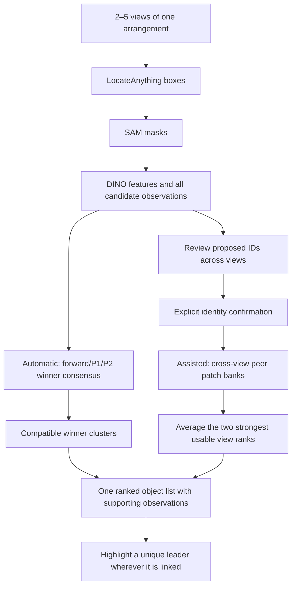

# Multi-view web integration and remaining evaluation

## Outcome

The existing app supports Automatic and Assisted modes for 2–5 views while
preserving Images, Results, Review and Report. The vision models remain
LocateAnything-3B, SAM 2.1 and DINOv2-small. Matching and scoring are frozen to
winner consensus for Automatic and object-bank top-two fusion for Assisted.
The bounded graph alternative did not improve development accuracy.

Every candidate remains reviewable and cached. Automatic ranking retains its
established winner-selection behavior because tested automatic all-candidate
association was weaker. Unmatched observations are not labelled normal or
absent. Assistance confirms which observations represent the same object; it
does not supply the anomaly answer. The app never looks up a dataset identity.

A database is unnecessary for this stage. Private per-session JSON/NPZ files
store masks/features; in-memory maps hold the object links. Identity-only edits
reuse features, while changed images or boxes invalidate affected candidates.
Cache capabilities, checksums, expiry and cancellation are tested. Reports
exclude capabilities and raw tensors.

## Measured development results

Tie-aware top-1, the same 100 development scenes and 27 asset groups, primary
view schedules. These are cached development measurements, not an independent
cohort or a fresh GPU evaluation of arbitrary uploads.

| Views | Current CPU automatic decision | Predicted masks + supplied IDs, selected assisted scorer |
| --- | ---: | ---: |
| 2 | 39.00% | 57.67% |
| 3 | 36.67% | 62.83% |
| 5 | 19.92% | 69.00% |

The automatic three-view 95% asset-group interval is 27.67–45.99%; the supplied-ID
three-view interval is 52.17–73.09%. The 60% target is reached as a development
point estimate under supplied correspondence, not established for Automatic or
for human confirmation in the app. More views currently help the supplied-ID
route and can hurt automatic matching.

The historical automatic three-view result was 37.67%. Recomputing its fixed
components from the shared CPU DINO cache changes three leading selections;
the measured difference is −1.00 percentage point (paired interval −2.53 to 0).
Both historical and current CPU values remain available. Do not mix their
runtime provenance or call the older number the current adapter's accuracy.

The historical winner loss accounting remains: 0 scenes lose all anomaly
candidates at detection, 19 lose them at winner pruning, and 10 at association,
leaving 71 rankable scenes. This is not a 71% detector ceiling. The inherited
`identity_reference_coverage` diagnostic has a calculation defect; 09E marks it
invalid and retains the original value only for audit. Ranking metrics are
unaffected.

Use [the selected-route figure](../../reports/web-integration/safe/selected_primary_top1.png)
for the main explanation and the complete technique tables for the comparison.
The report can include the strongest measured technique, provided it names its
route, view schedule, cohort and selection status. For example, explored mean
fusion reached 74.8% on the primary five-view predicted-mask/supplied-ID route;
that is not the selected top-two app method. Selected galleries illustrate
behavior and do not replace the full scene denominator.

## Notebook status

- 08N/08O and the bounded 08P comparison are retained with their original seals.
- Current-method 09/10 preparations live in the separate working project.
  The repository versions of those earlier notebooks retain the historical P1
  contract and are not current-method execution entrypoints.
- 09E was executed locally: six unchanged source cells, zero errors, 116
  registered technique/route/view-count conditions, seven aggregate figures,
  and 12 private galleries. It reuses existing predictions and evaluations.
- Galleries include original views, boxes, masks, objects on black, projected
  coarse heatmaps, per-view scores, fusion support, ties and failures. The
  highlighted box describes an object region, not a validated defect boundary.
- The sanitized executed notebook, aggregate tables/figures and 22 verified
  ClearML artifacts are available. Private images and per-object score tables
  remain outside the repository overlay.

See [09E's method and runtime notes](../experiments/remaining-cohort-workbench.md)
and [its ClearML receipt](../../reports/remaining-cohort-workbench/09e-clearml-publication.json).
The separate [app CPU publication receipt](../../reports/web-integration/clearml-publication.json)
records eight aggregate-only artifacts verified in ClearML; it did not rerun the
scientific work or upload private images.

## Remaining milestones

1. Audit the original asset exposure records. Keep the 1000 development / 600
   calibration / 400 internal-lock assignment. Re-shuffling does not remove
   earlier exposure. New scoring is verified on 100 development scenes, not all
   2000 scenes; the other 900 development scenes need a compatible cache bridge.
2. Implement native role-resource/cache and evaluator bridges for the frozen
   modes. The generic CPU prediction hook validates actual canonical scene
   membership and resume bindings, but it does not complete these native
   adapters or asset attribution. Protected stages remain blocked explicitly.
3. Confirm on a defensible remaining cohort once those conditions are resolved.
   Freeze each result before choosing report illustrations; retain failed and
   missing outcomes and asset-group uncertainty.
4. Run a Linux/GPU smoke test on new uploads, including 2/3/5 views, then record
   cold/warm latency, host/GPU memory and the full hosted journey. The local
   Docker daemon was unavailable. This stage did not deploy or run new
   LocateAnything/SAM inference.
5. Use the measured modes in the report and demonstrate both Automatic and
   Assisted. Three views are the main planned demo; the app also accepts two
   and five. Do not promise that every uploaded scene will be correct.

## Local handover

Completed app and notebook changes are prepared for review in
`multiview-physical-objects`, based on
`e4d2c3b326e53e4640203220a855404d79f388a6`. The primary submission checkout remains
clean on that commit. Ongoing work is stored in the separate working project under
`development/remaining-evaluation/`, based on its existing
`3c33d278f72494a28f2c8c9e442c2bc58cf0d472` history.

Only selected completed source, tests and sanitized evidence belong in the
repository change. Unexecuted drafts, private review evidence, recovery archives
and local environments are physically retained in the working project. Ignored
compatibility links preserve previously sealed paths. Older transfer archives
record their original branch and mixed preparation scope; they are historical
recovery snapshots, not the file list for the current review. No merge is part
of this stage.
