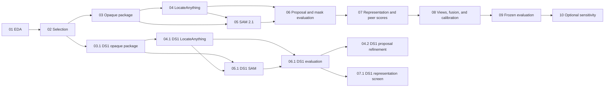

# Notebook sequence

The notebooks are ordered experiment entry points. Reusable preparation,
model, scoring, evaluation, and tracking logic belongs in tested modules under
`src/visual_peer_inspector/`.

## Current sequence

| Notebook | Responsibility | Status |
| --- | --- | --- |
| 01 Full Dataset EDA | Audits the full catalogue, archive inventory, labels, views, data quality, and leakage risks | Complete |
| 02 Selection Audit | Verifies the controlled 2,000-scene roles, coverage, base-asset separation, and release evidence | Complete |
| 03 Opaque Package Smoke | Builds and verifies the model-safe 20-scene, 400-image DS0 RGB package | Complete candidate evidence |
| 04 Box Proposals | Runs pinned LocateAnything on DS0 and records frozen proposal evidence | Complete candidate evidence |
| 05 Segmentation | Runs pinned SAM 2.1 for the reference-box and automatic-box routes | Complete candidate evidence |
| 06 Proposal and Mask Evaluation | Compares proposals and masks with protected references inside evaluator-only code | Complete candidate evidence |
| 07 Representation and Peer Scores | Adds feature caching, encoder screening, B0, B1, P1, geometry, and heatmaps | Kaggle DS0 candidate evidence complete; DINOv3 access pending |
| 03.1 DS1 Opaque Package | Verifies the label-free 100-scene, 2,000-image DS1 input package | Complete clean-snapshot evidence |
| 04.1 DS1 Box Proposals | Runs pinned LocateAnything on all 2,000 DS1 images | Complete clean-snapshot evidence |
| 05.1 DS1 Segmentation | Runs pinned SAM 2.1 for supplied and automatic boxes | Complete clean-snapshot evidence |
| 06.1 DS1 Proposal and Mask Evaluation | Measures DS1 proposal and mask quality with protected references | Complete; refine or replace LocateAnything |
| 04.2 DS1 Proposal Refinement | Tests fixed label-free filters on the frozen LocateAnything proposals | Complete candidate evidence; recall gate still fails |
| 08 Views, Fusion, and Calibration | Evaluates view subsets, identity association, fusion, thresholds, and review rules | Planned |
| 09 Frozen Evaluation | Opens internal-lock and official evaluation only after settings and predictions are frozen | Planned |
| 10 Full-Pool Sensitivity | Runs the optional role-preserving 4,107-scene analysis after the primary method freezes | Optional |

Candidate evidence is valid implementation evidence from a verified
pre-commit source snapshot that recorded `git_dirty: true`. The original run
record must remain unchanged. A clean-snapshot rerun may later replace a
candidate result.

## Dependency flow

## Notebook locations

- Notebook 01:
  `eda/toysad8k-full-dataset/toysad-8k-full-dataset-eda.ipynb`
- Notebook 02:
  `data-preparation/toysad8k-selection-audit/toysad8k-2000-selection-audit.ipynb`
- Notebook 03:
  `data-preparation/toysad8k-opaque-package-smoke/toysad8k-opaque-package-smoke.ipynb`
- Notebook 04:
  `detection-and-segmentation/toysad8k-ds0-locateanything/toysad8k-ds0-locateanything-proposals.ipynb`
- Notebook 05:
  `detection-and-segmentation/toysad8k-ds0-sam21/05-toysad8k-ds0-sam21-segmentation.ipynb`
- Notebook 06:
  `detection-and-segmentation/toysad8k-ds0-mask-evaluation/06-toysad8k-ds0-mask-evaluation.ipynb`
- Notebook 07:
  `representation-and-scoring/toysad8k-ds0-peer-scores/07-toysad8k-ds0-representation-and-peer-scores.ipynb`
- Notebook 03.1:
  `data-preparation/toysad8k-ds1-opaque-package/03.1-toysad8k-ds1-opaque-package.ipynb`
- Notebook 04.1:
  `detection-and-segmentation/toysad8k-ds1-locateanything/04.1-toysad8k-ds1-locateanything-screen.ipynb`
- Notebook 05.1:
  `detection-and-segmentation/toysad8k-ds1-sam21/05.1-toysad8k-ds1-sam21-segmentation.ipynb`
- Notebook 06.1:
  `detection-and-segmentation/toysad8k-ds1-mask-evaluation/06.1-toysad8k-ds1-proposal-and-mask-evaluation.ipynb`
- Notebook 04.2:
  `detection-and-segmentation/toysad8k-ds1-proposal-refinement/04.2-toysad8k-ds1-proposal-refinement.ipynb`

Planned notebook directories are created only when their design and required
inputs are ready.

## Acceptance rules

An accepted notebook stage must:

1. use pinned and hashed inputs, code, models, and configuration;
2. keep source identifiers, labels, roles, and private protocol fields outside
   model-facing resources;
3. support deterministic restart or resume behaviour where applicable;
4. produce a clean notebook source with no saved execution outputs;
5. store large or private outputs outside GitHub;
6. retain a sanitized run record, aggregate tables, figures, and checksums;
7. record approved aggregate evidence in ClearML or preserve a synchronized
   offline record when ClearML is unavailable;
8. include failures and negative results, not only successful examples; and
9. pass the repository tests and `git diff --check` before review.

## Notebook 07 entry conditions

Notebook 07 must consume the frozen, label-free mask-route package created by
Notebook 06. The first run should validate B0, B1, and P1 on DS0 without
changing proposal or mask settings. The 100-scene DS1 screen should then:

- screen the bounded encoder candidates on supplied masks;
- compare downstream results across the three mask routes;
- add geometry without mixing it into the appearance encoder;
- report one-anomaly and two-anomaly ranking measures separately;
- use paired uncertainty grouped by base asset;
- store feature caches outside GitHub and ClearML; and
- save report-ready score tables, heatmaps, failure examples, runtime, memory,
  and a clear promote-or-stop decision.
