# Notebook sequence

The notebooks are ordered experiment entry points. Reusable preparation,
model, scoring, evaluation, and tracking logic belongs in tested modules under
`src/visual_peer_inspector/`.

## Current sequence

| Notebook | Responsibility | Status |
| --- | --- | --- |
| 01 Full Dataset EDA | Audits the full catalogue, archive inventory, labels, views, data quality, and leakage risks | Complete |
| 02 Selection Audit | Verifies the controlled 2,000-scene roles, coverage, base-asset separation, and release evidence | Complete |
| 03 Opaque Package Smoke | Builds and verifies the model-safe 20-scene, 400-image DS0 RGB package | Complete candidate evidence |
| 04 Box Proposals | Runs pinned LocateAnything on DS0 and records frozen proposal evidence | Complete candidate evidence |
| 05 Segmentation | Runs pinned SAM 2.1 for the reference-box and automatic-box routes | Complete candidate evidence |
| 06 Proposal and Mask Evaluation | Compares proposals and masks with protected references inside evaluator-only code | Complete candidate evidence |
| 07 Representation and Peer Scores | Adds feature caching, encoder screening, B0, B1, P1, geometry, and heatmaps | Kaggle DS0 candidate evidence complete |
| 03.1 DS1 Opaque Package | Verifies the label-free 100-scene, 2,000-image DS1 input package | Complete clean-snapshot evidence |
| 04.1 DS1 Box Proposals | Runs pinned LocateAnything on all 2,000 DS1 images | Complete clean-snapshot evidence |
| 05.1 DS1 Segmentation | Runs pinned SAM 2.1 for supplied and automatic boxes | Complete clean-snapshot evidence |
| 06.1 DS1 Proposal and Mask Evaluation | Measures DS1 proposal and mask quality with protected references | Complete; refine or replace LocateAnything |
| 04.2 DS1 Proposal Refinement | Tests fixed label-free filters on the frozen LocateAnything proposals | Complete candidate evidence; precision improved but misses remain |
| 07.1 DS1 Representation and Peer Scores | Screens encoders and B0, B1 and P1 on all 100 DS1 scenes | Complete candidate evidence; DINOv2-small with P1 selected |
| 04.3 DS1 LocateAnything Prompt Freeze | Compares two supported generic prompts and freezes one prompt and post-processing policy | Kaggle Version 4 verified; `individual object` with `area_nms_075_cap8` selected |
| 08A DS2 Confirmation Release | Builds the untouched 300-scene RGB, geometry, and protected evaluator resources | Kaggle Version 5 verified; three private resources published and checked |
| 08B DS2 Frozen Pipeline | Runs LocateAnything, reference-box and automatic-box SAM 2.1, and frozen DINOv2-small with B0 and P1 on all 6,000 views | Kaggle Version 4 complete; compact bundles verified |
| 08C DS2 Confirmation and Multi-view | Measures proposals, masks, B0/P1 rankings, view counts, fusion, subgroups, and confirmation status | Kaggle Version 1 complete; development confirmation measured |
| 08D Primary Protocol Release | Verifies the 1,000/600/400 primary roles and releases only the remaining 600 development scenes | Kaggle V2 complete; executed notebook and output bundles verified |
| 08E Frozen Development Pipeline | Runs the fixed automatic pipeline on the 1,000 development scenes and locks complete predictions | Kaggle V5 complete; 20,000 views locked, 1,007 files verified and 90 review figures saved |
| 08E.1 Development Identity Evaluator Release | Opens raw reference masks only after the 1,000-scene prediction lock and publishes `vpi-toysad-development-identity-evaluator` | V4 complete and verified; 80,954 correspondence records; V3 rejected for reference decoding |
| 08F Cross-View Identity Freeze | Selects label-free identity matching and freezes the application output contract | V1 complete; embedding-only retained, 3,000 application results; five-view identity accuracy 33.04% |
| 08G Development Scoring Comparison | Reuses the fixed 100-scene development screen and DINOv2-small feature cache to calculate P1 and eight bounded alternatives | V2 complete; 100 scenes, 2,000 views and both routes verified |
| 08H Development Scoring Evaluation | Compares the nine scorers across routes, identity modes and view counts using asset-grouped uncertainty | V2 complete; no scorer promoted automatically; predicted cross-view identity remains the main limitation |
| 08I Development Identity Refinement | Compares global, foreground patch, and hybrid identity descriptors on the same 100-scene development screen | V3 complete; top-1 improved but identity-link F1 fell, so no candidate was promoted |
| 08F.1 Calibration Resource Release | Publishes the physically separate `vpi-toysad-calibration600-model-input` and `vpi-toysad-calibration600-evaluator` resources after the method freeze | Built and locally checked; Kaggle evidence pending |
| 09A Calibration Inference | Produces locked, prediction-only output for all 600 calibration scenes | Built and locally checked; Kaggle evidence pending |
| 09B Calibration Review Policy | Opens calibration references after the prediction lock and freezes only the optional review policy | Built and locally checked; Kaggle evidence pending |
| 09B.1 Internal-Lock Resource Release | Publishes the physically separate `vpi-toysad-internal-lock400-model-input` and `vpi-toysad-internal-lock400-evaluator` resources after the method and policy freezes | Built and locally checked; Kaggle evidence pending |
| 09C Internal-Lock Inference | Produces locked, prediction-only output for all 400 internal-lock scenes | Built and locally checked; Kaggle evidence pending |
| 09D Internal-Lock Evaluation | Performs the one-shot internal evaluation without retuning | Built and locally checked; Kaggle evidence pending |
| 10R Official Release | Builds separate model-facing and evaluator-only resources for the official seen and unseen roles | Built and locally checked; Kaggle evidence pending |
| 10A Seen Inference | Runs the unchanged frozen route on official seen inputs | Built and locally checked; Kaggle evidence pending |
| 10A.1 Unseen Inference | Runs the unchanged frozen route on official unseen inputs | Built and locally checked; Kaggle evidence pending |
| 10A Finalize | Verifies both prediction resources and publishes an aggregate-only cross-split lock summary | Built and locally checked; Kaggle evidence pending |
| 10B Official Evaluation | Performs the final one-shot seen and unseen evaluation without retuning | Built and locally checked; Kaggle evidence pending |
| 11R Full-Pool Release | Creates separate model-facing and evaluator-only resources after Notebook 10B | Built and locally checked; optional execution |
| 11A Full-Pool Frozen Inference | Runs the unchanged frozen route on 4,107 eligible scenes with sharded recovery | Built and locally checked; optional execution |
| 11B Full-Pool Sensitivity Evaluation | Reports descriptive role-preserving results without retuning | Built and locally checked; optional execution |

Candidate evidence is valid implementation evidence from a verified
pre-commit source snapshot that recorded `git_dirty: true`. The original run
record must remain unchanged. A clean-snapshot rerun may later replace a
candidate result.

The current DS2 decision keeps LocateAnything, SAM 2.1 Hiera-large,
DINOv2-small, P1, two to five declared views, and normalized-rank fusion. B0
remains the baseline. The automatic result is the normal route. Human box or
identity correction is an optional rerun when the evidence is incomplete or
uncertain. This is a development freeze for the next calibration stage, not a
final production claim. The completed 08F comparison shows weak physical-object
identity matching despite passing its structural checks. Review that limitation
before the protected stages. If the method changes, produce a new development
comparison and method lock without using calibration or internal-lock labels.

## Dependency flow

```mermaid
flowchart LR
    N1["01 EDA"] --> N2["02 Selection"]
    N2 --> N3["03 Opaque package"]
    N3 --> N4["04 LocateAnything"]
    N4 --> N5["05 SAM 2.1"]
    N3 --> N5
    N4 --> N6["06 Proposal and mask evaluation"]
    N5 --> N6
    N6 --> N7["07 Representation and peer scores"]
    N7 --> N8A["08A DS2 confirmation release"]
    N8A --> N8B["08B Frozen pipeline"]
    N8B --> N8C["08C Confirmation and multi-view"]
    N8C --> N8D["08D Primary protocol release"]
    N8D --> N8E["08E Development pipeline"]
    N8E --> N8E1["08E.1 Development identity evaluator release"]
    N8E1 --> N8F["08F Identity and method freeze"]
    N8F --> N8G["08G Development scoring comparison"]
    N8G --> N8H["08H Development scoring evaluation"]
    N8H --> N8I["08I Development identity refinement"]
    N8I --> N8F1["08F.1 Calibration resource release"]
    N8F1 --> N9A["09A Calibration inference"]
    N9A --> N9B["09B Review-policy freeze"]
    N9B --> N9B1["09B.1 Internal-lock resource release"]
    N9B1 --> N9C["09C Internal-lock inference"]
    N9C --> N9D["09D One-shot internal evaluation"]
    N9D --> N10R["10R Official release"]
    N10R --> N10A["10A Seen inference"]
    N10R --> N10A1["10A.1 Unseen inference"]
    N10A --> N10AF["10A Finalize prediction summary"]
    N10A1 --> N10AF
    N10AF --> N10B["10B Seen and unseen evaluation"]
    N10B --> N11R["11R Optional full-pool release"]
    N11R --> N11A["11A Frozen full-pool inference"]
    N11A --> N11B["11B Descriptive sensitivity evaluation"]
    N2 --> N31["03.1 DS1 opaque package"]
    N31 --> N41["04.1 DS1 LocateAnything"]
    N31 --> N51["05.1 DS1 SAM"]
    N41 --> N51
    N41 --> N61["06.1 DS1 evaluation"]
    N51 --> N61
    N61 --> N42["04.2 DS1 proposal refinement"]
    N42 --> N43["04.3 DS1 prompt and policy freeze"]
    N43 --> N8B
    N61 --> N71["07.1 DS1 representation screen"]
```

## Notebook locations

- Notebook 01:
  `eda/toysad8k-full-dataset/toysad-8k-full-dataset-eda.ipynb`
- Notebook 02:
  `data-preparation/toysad8k-selection-audit/toysad8k-2000-selection-audit.ipynb`
- Notebook 03:
  `data-preparation/toysad8k-opaque-package-smoke/toysad8k-opaque-package-smoke.ipynb`
- Notebook 04:
  `detection-and-segmentation/toysad8k-ds0-locateanything/toysad8k-ds0-locateanything-proposals.ipynb`
- Notebook 05:
  `detection-and-segmentation/toysad8k-ds0-sam21/05-toysad8k-ds0-sam21-segmentation.ipynb`
- Notebook 06:
  `detection-and-segmentation/toysad8k-ds0-mask-evaluation/06-toysad8k-ds0-mask-evaluation.ipynb`
- Notebook 07:
  `representation-and-scoring/toysad8k-ds0-peer-scores/07-toysad8k-ds0-representation-and-peer-scores.ipynb`
- Notebook 03.1:
  `data-preparation/toysad8k-ds1-opaque-package/03.1-toysad8k-ds1-opaque-package.ipynb`
- Notebook 04.1:
  `detection-and-segmentation/toysad8k-ds1-locateanything/04.1-toysad8k-ds1-locateanything-screen.ipynb`
- Notebook 05.1:
  `detection-and-segmentation/toysad8k-ds1-sam21/05.1-toysad8k-ds1-sam21-segmentation.ipynb`
- Notebook 06.1:
  `detection-and-segmentation/toysad8k-ds1-mask-evaluation/06.1-toysad8k-ds1-proposal-and-mask-evaluation.ipynb`
- Notebook 04.2:
  `detection-and-segmentation/toysad8k-ds1-proposal-refinement/04.2-toysad8k-ds1-proposal-refinement.ipynb`
- Notebook 07.1:
  `representation-and-scoring/toysad8k-ds1-peer-scores/07.1-toysad8k-ds1-representation-and-peer-scores.ipynb`
- Notebook 04.3:
  `detection-and-segmentation/toysad8k-ds1-locateanything-prompt-freeze/04.3-toysad8k-ds1-locateanything-prompt-freeze.ipynb`
- Notebook 08A:
  `confirmation-and-multiview/08a-toysad8k-ds2-confirmation-release.ipynb`
- Notebook 08B:
  `confirmation-and-multiview/08b-toysad8k-ds2-frozen-pipeline.ipynb`
- Notebook 08C:
  `confirmation-and-multiview/08c-toysad8k-ds2-confirmation-and-multiview.ipynb`
- Notebook 08D:
  `development-freeze/08d-toysad8k-primary-protocol-release.ipynb`
- Notebook 08E:
  `development-freeze/08e-toysad8k-frozen-development-pipeline.ipynb`
- Notebook 08E.1:
  `development-freeze/08e1-toysad8k-development-identity-evaluator-release.ipynb`
- Notebook 08F:
  `development-freeze/08f-toysad8k-cross-view-identity-freeze.ipynb`
- Notebook 08G:
  `representation-and-scoring/development-scoring-comparison/08g-development-scoring-comparison.ipynb`
- Notebook 08H:
  `representation-and-scoring/development-scoring-comparison/08h-development-scoring-evaluation.ipynb`
- Notebook 08I:
  `representation-and-scoring/development-identity-refinement/08i-development-identity-refinement.ipynb`
- Notebook 08F.1:
  `protected-evaluation/08f1-toysad8k-calibration-resource-release.ipynb`
- Notebook 09A:
  `protected-evaluation/09a-toysad8k-protected-calibration-inference.ipynb`
- Notebook 09B:
  `protected-evaluation/09b-toysad8k-calibration-review-policy.ipynb`
- Notebook 09B.1:
  `protected-evaluation/09b1-toysad8k-internal-lock-resource-release.ipynb`
- Notebook 09C:
  `protected-evaluation/09c-toysad8k-protected-internal-lock-inference.ipynb`
- Notebook 09D:
  `protected-evaluation/09d-toysad8k-internal-lock-one-shot-evaluation.ipynb`
- Notebook 10R:
  `official-evaluation/10r-toysad8k-official-release.ipynb`
- Notebook 10A:
  `official-evaluation/10a-toysad8k-official-seen-frozen-inference.ipynb`
- Notebook 10A.1:
  `official-evaluation/10a1-toysad8k-official-unseen-frozen-inference.ipynb`
- Notebook 10A Finalize:
  `official-evaluation/10a-finalize-toysad8k-official-prediction-summary.ipynb`
- Notebook 10B:
  `official-evaluation/10b-toysad8k-official-seen-unseen-evaluation.ipynb`
- Notebook 11R:
  `post-freeze-sensitivity/11r-toysad8k-full-pool-release.ipynb`
- Notebook 11A:
  `post-freeze-sensitivity/11a-toysad8k-full-pool-frozen-inference.ipynb`
- Notebook 11B:
  `post-freeze-sensitivity/11b-toysad8k-full-pool-sensitivity-evaluation.ipynb`

Notebook 11 source is ready, but execution remains optional. Start it only
after Notebook 10B is complete and the official result is fixed. It cannot be
used to revise the frozen method or policy.

## Acceptance rules

An accepted notebook stage must:

1. use pinned and hashed inputs, code, models, and configuration;
2. keep source identifiers, labels, roles, and private protocol fields outside
   model-facing resources;
3. support deterministic restart or resume behaviour where applicable;
4. produce a clean notebook source with no saved execution outputs;
5. store large or private outputs outside GitHub, with a separate sanitised
   saved-output copy allowed for repository evidence;
6. retain a sanitized run record, aggregate tables, figures, and checksums;
7. record approved aggregate evidence in ClearML or preserve a synchronized
   offline record when ClearML is unavailable;
8. include failures and negative results, not only successful examples; and
9. pass the repository tests and `git diff --check` before review.

## Notebook 07 entry conditions

Notebook 07 must consume the frozen, label-free mask-route package created by
Notebook 06. The first run should validate B0, B1, and P1 on DS0 without
changing proposal or mask settings. The 100-scene DS1 screen should then:

- screen the bounded encoder candidates on supplied masks;
- compare downstream results across the three mask routes;
- add geometry without mixing it into the appearance encoder;
- report one-anomaly and two-anomaly ranking measures separately;
- use paired uncertainty grouped by base asset;
- store feature caches outside GitHub and ClearML; and
- save report-ready score tables, heatmaps, failure examples, runtime, memory,
  and a clear promote-or-stop decision.
