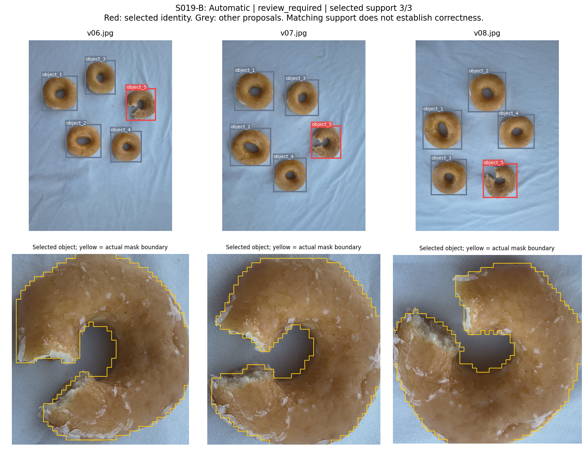
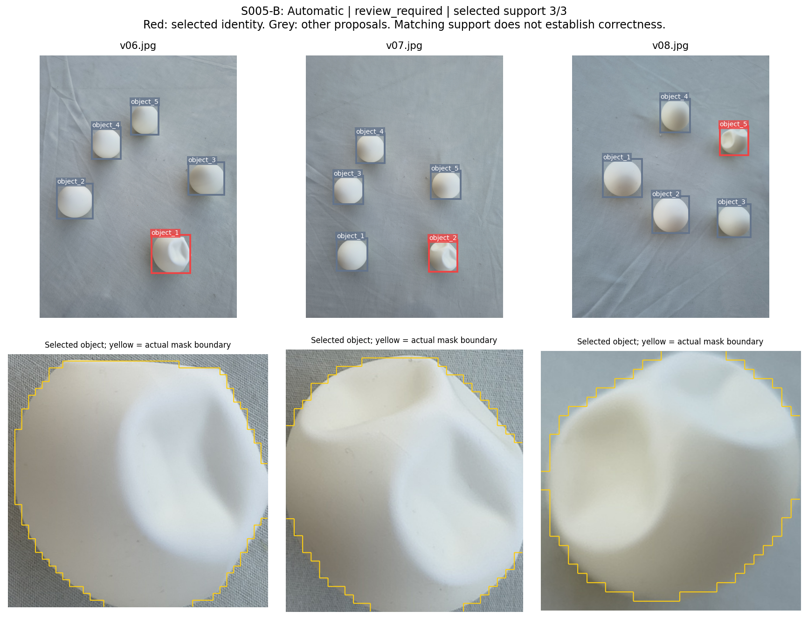
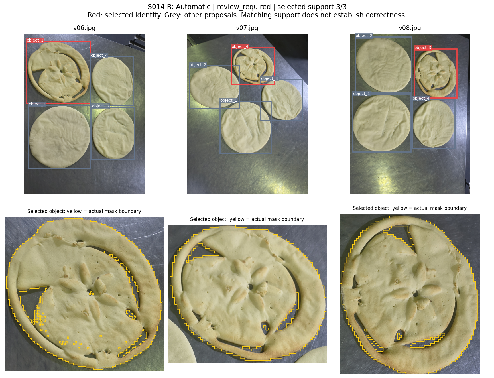
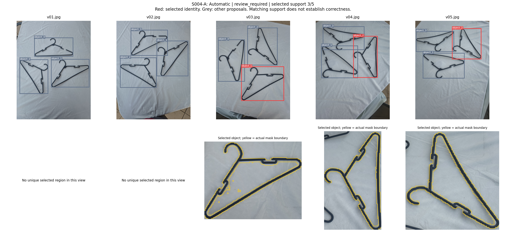
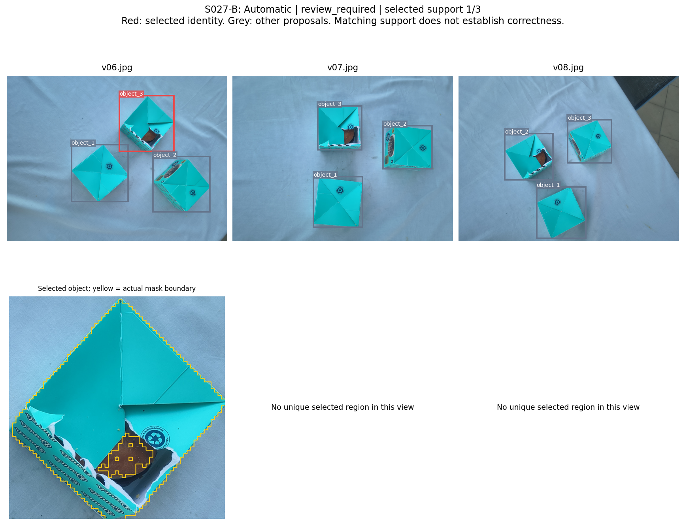

# Team-collected real-photo study

The frozen Automatic pipeline completed **58 inspections covering 29 scenes and
231 unique photographs**, with no execution failures, on 13 October 2026.
Vaibhav Bairathi photographed the arrangements and organised, split and renamed
the source collection. Sreekar Reddy Edulapalli prepared and ran the Kaggle
batches and integrated the evidence. The collection includes 27 additional
scenes and two earlier demonstration scenes; capture dates are not verified.

This is a supplementary qualitative study of controlled peer arrangements.
It provides evidence of execution on team-collected photographs. It does not
establish real-photo accuracy or replace the protected ToysAD benchmark.

## Representative results

The bitten plain doughnut (S019-B), dented white ball (S005-B) and torn dough
base (S014-B) were selected consistently across their three supplied views.
The doughnut and ball also had consistent selections in their separate
five-view inspections. These examples were selected after reviewing the full
batch; all outcomes remain in the result tables.







Red boxes show the selected identity; grey boxes show other proposals. Where
shown, yellow boundaries come from the saved SAM whole-object masks. They are
not annotations of the defective pixels. Matching support alone does not
establish correctness.

## Complete findings and limitations

| Qualitative visual judgement | Inspections |
| --- | ---: |
| Visible anomaly selected across every supplied view | 10 |
| Visible anomaly selected with partial view support | 38 |
| Different normal object selected | 6 |
| Mixed normal and anomalous objects linked as the selection | 2 |
| No unique selection | 2 |
| **Total completed** | **58** |

These are Codex qualitative image-review judgements, not independently
annotated accuracy measurements. All 58 inspections retained `review_required`
under the unchanged Automatic policy. Ten selected-mask cases were also
visually examined individually. The 58 inspections reuse 29 physical scenes
and must not be treated as 58 independent scenes. There was no all-normal
cohort, Assisted evaluation, or deployed web-app replay in this study.

A hanger inspection selected a normal object (S004-A). The torn teal box was
selected in only one of three views in S027-B, illustrating incomplete
correspondence even when the anomaly was visible.





## Collection and execution protocol

One exact duplicate spoon photo was excluded from 232 supplied photographs.
The 231 retained images were orientation-corrected, converted to RGB and
resized to a maximum long edge of 3,072 pixels using LANCZOS, then saved as
JPEG quality 95 with subsampling 0. The originals were preserved separately.
The [collection inventory](collection-inventory.json) records source names
and original/resized hashes. Descriptive names were not passed to inference.

Each scene generated an A inspection using its first five views and a B
inspection using the remaining three views (two for the spoon scene S009).
These inspection suffixes differ from the **Kaggle notebook parts**: notebook
Part A processed scenes S001-S015, with 30 inspections and 119 photos; notebook
Part B processed S016-S029, with 28 inspections and 112 photos.

Inference used source commit `5b78942e29fe7186458c6a13306eeba2657fc3e6`,
LocateAnything-3B, SAM 2.1 Hiera-large, DINOv2-small and the frozen
`winner_cluster_consensus` Automatic route. No anomaly labels were mounted
and no thresholds, model weights or decision rules were tuned on these photos.
The [input manifest](input-manifest.json) binds all images, 158 source files
and the batch runner. Its SHA-256 is
`c9e3b280fbccf6dc0fbe0b0972b52a936efb038733b999a35951fe72eaaf9d7a`.

Successful Kaggle Version 3 runs used a pinned CPython 3.12 container, T4 GPU
and offline prepared resources. The runner verifies the exact permitted
prepared/current configuration pair, preserves the current review policy,
and checks model revisions and asset hashes. Both runs passed all eight
startup checks. The original observed runtime, run bindings, summaries and
archive receipts are consolidated in the [publication receipt](publication-receipt.json).

## Evidence and reproduction

- [Executed Part A](../../notebooks/executed/real-photo-evaluation/vpi-real-photo-29-part-a-20261013.ipynb)
  and [executed Part B](../../notebooks/executed/real-photo-evaluation/vpi-real-photo-29-part-b-20261013.ipynb)
  are unchanged successful downloads, including their outputs.
- [Automatic result table](automatic-inspection-results.csv): all 58 inspections,
  selections, support, review reasons and observed execution times.
- [Visual review](visual-review.csv) and [scene review](scene-review.csv): complete
  qualitative findings, including failures; [descriptive summary](descriptive-summary.json).
- [Consolidated case results](case-results.json): all original result JSON
  objects. Mask and heatmap names refer to the full archives outside Git.
- [Runnable Part A](../../notebooks/real-photo-evaluation/a/real-photo-batch.ipynb)
  and [Part B](../../notebooks/real-photo-evaluation/b/real-photo-batch.ipynb)
  have adjacent Kaggle metadata with the exact container and mounted resources.
- [Artifact lock](artifact-lock.json): SHA-256 inventory of this compact addition.

The [input dataset](https://www.kaggle.com/datasets/esreekarreddy/vpi-real-photo-29-rgb-20261013)
and [Kaggle Part A](https://www.kaggle.com/code/esreekarreddy/vpi-real-photo-29-part-a-20261013)
and [Part B](https://www.kaggle.com/code/esreekarreddy/vpi-real-photo-29-part-b-20261013)
are private resources and require authorised account access. Their full output
archives, native masks, feature caches and complete gallery remain outside
Git. The archive hashes in the publication receipt bind those larger artifacts.

To verify or rebuild the input package from the exact resized `rgb/` directory,
run from the repository root with Python 3.11 or newer:

```bash
python3 scripts/real_photo/prepare_input_package.py --rgb-root /path/to/rgb --verify-only
python3 scripts/real_photo/prepare_input_package.py --rgb-root /path/to/rgb --output /path/to/new-batch
```

The builder retrieves the evaluated source from the frozen Git commit, checks
all input/source/runner hashes, and writes `batch.zip`. It does not resize fresh
images. ZIP timestamps may change the archive hash while the bound contents
remain identical. The private Kaggle dataset already contains the evaluated
package, so rebuilding is optional. To reproduce the runs, attach that dataset
and both prepared `vpi-current-setup-regions` and `vpi-current-setup-dino` notebook
resources, preserve the supplied pinned container/GPU settings, and execute the
two source notebooks. Execution may incur GPU usage; this publication did not
launch another run or change the final report.
